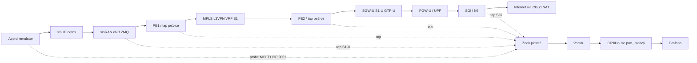
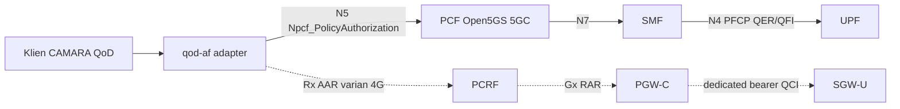

# Arsitektur Lintas5G (fase 1)

Label: **FAKTA** = sudah diuji di lab on-prem atau uji IaC GCP 17 Nov 2026. **USULAN** = desain, belum diuji end-to-end.

## Komponen

| Lapisan | Komponen | Status |
|---|---|---|
| Core | Open5GS 2.8.0 EPC CUPS (MME, SGW-C/U, PGW-C/U = SMF/UPF, HSS, PCRF) | FAKTA (lab on-prem) |
| RAN | srsRAN 4G eNB + srsUE, radio virtual ZMQ, UE di netns | FAKTA |
| UE app | Emulator Android (internet via proxy HTTP CONNECT di netns UE) + app VpnService dengan probe MGLT | FAKTA |
| Transport | Backhaul MPLS S1 (PE1–P1/P2–PE2, FRR OSPF+LDP, L3VPN VRF `S1`) | USULAN |
| Pengukuran | Zeek `pktlat2.zeek` v2.1 (per paket QUIC) → Vector → ClickHouse `poc_latency` → Grafana | FAKTA (Zeek/ClickHouse/Grafana), USULAN (Vector) |
| Telco API | Adapter CAMARA QoD → N5 (Npcf_PolicyAuthorization) / Rx | SKELETON |
| Infra | GCP asia-southeast2, 3 VM tanpa IP publik, IAP, Cloud NAT | FAKTA (apply/smoke/destroy) |

## Alur data end-to-end

Latency dipecah per segmen: **app→S1-U** (radio + stack UE), **S1-U→PE2** (transport MPLS), **S1-U→SGi** (core), **SGi→internet**.

## Kontrol QoS (QoD)

Diferensiasi saat kontensi dibuat dengan bottleneck `tc` HTB di N6/SGi atau di backhaul MPLS (UPF Open5GS tidak menjadwalkan prioritas per QFI). Detail: [qod-feasibility-test.md](qod-feasibility-test.md).

## Dokumen terkait

- [gcp-lab.md](gcp-lab.md) — topologi GCP, sizing, biaya, keamanan.
- [latency-poc.md](latency-poc.md) — metode pengukuran latency per paket.
- [qod-feasibility-test.md](qod-feasibility-test.md) — rencana uji 2 hari QoD.
- [licensing.md](licensing.md) — lisensi.
