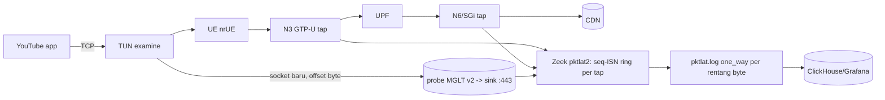

# Rencana desain: dukungan TCP pada pengukuran latency per paket (skeleton)

Status: DESAIN SAJA. Implementasi menunggu konfirmasi langsung user. Arahan user (diparafrasekan via agen, 19 Nov 22:43 WIB):
YouTube (mayoritas TCP/443) di sel padat + booster = kasus utama whitepaper, jadi pengukuran per paket harus mendukung TCP.
Ini membalik keputusan 17 Nov (probe per paket hanya QUIC, `tcppkt` off).

## 1. Kondisi sekarang (FAKTA)
- App examine v0.9 sudah punya mode TCP per paket berbasis **byte offset stream**: record per `write` (UL) / `read` (DL) app
  `(typ, flags, len, off, t_ns, aux)` dikirim lewat probe MGLT v2 ke sink. Sejak v0.9.1 dimatikan default (`tcpPkt = false`,
  extra `--es tcppkt on`), `ExamineVpnService.java:58-62,106,437-554` (baseline v0.10.2).
- Zeek `pktlat2.zeek` masih memuat jalur TCP: ring segmen per flow per arah, offset = `seq − ISN − 1` dari frame mentah
  (`aseq`, termasuk ekstensi GTP), join per byte (`find`/`idx_le`), dedupe kiriman ulang (first-seen), pemetaan fid↔flow kabel
  lewat urutan SYN (`map_window` 2 s) — `pktlat2.zeek:251-290, 310-372, 390-466`; dimatikan dengan `const tcp_on = F` (`:31`).
- Validasi v0.9 (Chrome, lab offline 17 Nov, `poc-latency/phase2/results/p3-run-20261117-164955/compare-rt.txt`): cakupan 100%
  UL 81/81 & DL 387/387 di s1u/s5s8/sgi, |Δ| per paket vs analisis offline p50 0,4–0,7 ms. Overhead probe 7,3% dari UL+DL
  (168% dari UL Chrome), 0,36 probe per paket (`overhead.txt`). Zeek mem 271 MB pada 344 segmen ring.
- QUIC v2.1: kunci `md5(payload UDP[0:64])[0:8]` (`pktlat2.zeek:30-34,524`).
- Sumber angka booster r1 (p99 5476→1547,5 ms): **MGLT v1 echo RTT in-app (marker ke reflector :443)**, bukan korelasi paket app
  (`booster-app/observability/clickhouse/e2e-20261119/RESULTS.md:12,17-23`; `booster_mglt_window.jsonl`).

## 2. Desain kunci korelasi TCP (USULAN)
- **Jangan hash per paket.** App adalah forwarder TCP yang mengakhiri koneksi di TUN dan membuka socket baru ke server; seq di TUN
  ≠ seq di kabel, batas segmen berbeda (TSO/GRO, MSS VPN). Kunci yang stabil = **(flow kabel, arah, offset byte stream)**:
  app mencatat offset socket sisi-kabel; Zeek menghitung `seq − ISN` di tiap tap. Join rentang byte `[off, off+len)`.
- NAT/CGNAT/UPF: port/IP berubah, seq tidak (FAKTA 17 Nov: "ISN tidak berubah di slirp/SNAT/GTP", `poc-latency/phase2/README.md:83`).
  Pemetaan flow: SYN order + dst + jendela waktu (sudah ada); tambah 4-tuple sisi-kabel dari `getLocalSocketAddress` (sudah dicatat `pl.est`).
- Retransmisi: first-seen per byte di tiap tap (latency), hitung terpisah `retx_bytes` (kolom baru), dedupe record probe (`seen_rec`).
- Segmentasi: join per byte membuat TSO/GRO tidak relevan; tetap matikan GRO/LRO di veth tap (`ethtool -K`) agar ts per segmen kabel.
- ACK-only/zero payload: skip untuk latency data; opsional `ack_rtt` dari ACK UL (kolom terpisah).
- TLS: payload acak tidak dipakai sebagai kunci (tidak perlu). MTU/MSS VPN: MSS diumumkan app (SYN-ACK hanya MSS) — catat MSS per flow.

## 3. Overhead & sampling (USULAN)
- Full coverage pada YouTube TCP puluhan Mbit/s = ribuan record/s. Usulan: **sampling deterministik di kedua sisi** dengan
  `hash(flow_id, off_block) mod N == 0`, blok 16 KiB (app & Zeek memakai fungsi yang sama), N=4–16; plus **jendela waktu**
  (Zeek hanya aktif 60 s pra-boost + 60 s boost, constraint user 22:48). Biaya CPU diukur per proses di run (top 10 s).
- Ring Zeek dibatasi `max_total_segs` (200k) → di sampling hanya simpan segmen yang overlap blok tersampel.

## 4. Perbaikan pending (FAKTA/USULAN)
- Probe IPv4: FAKTA sudah di v0.10.1 (`ExamineVpnService.java:60`, socket Inet4). Cek `VPN_CONSENT probe=…` tiap run.
- Tap setelah shaper: hanya relevan di Sesi D (HTB/sgiq). Booster sa-oai: bottleneck = sel; N3↔UE-tun membungkus antrean RAN.
- N3 coverage 86–96% di bawah beban (ZMQ di lo): USULAN `nr_exclude_zmq_from_n3_tap=true` + buffer tcpdump −B lebih besar.
- Skew ≈130 ms: pakai kalibrasi v4 (skew-guest.py) di awal dan akhir tiap rep; interpolasi linear.
- CDN: booster.4 `cdn on`, `cdnprefix 20`, ≤2 subnet (adapter 0.1.2).

## 5. Rencana run & fase implementasi (USULAN, jam)
| Fase | Pemilik | Jam |
|---|---|---|
| App: aktifkan tcppkt + sampling blok + offset sisi-kabel + retx | Booster App Dev | 6–8 |
| Zeek: `tcp_on` + sampling + kolom retx/ack_rtt + GRO off | PoC Architect | 6–8 |
| ClickHouse/Grafana: tabel pktlat TCP, view per fase | Booster App Dev | 3–4 |
| Validasi offline (n5-*: iperf3 TCP bulk + replay TCP mirip YouTube) | PoC Architect | 4–6 |
| Run GCP (pola r3: A/N rep) | PoC Architect | 2 (≈USD 1,5) |
Run YouTube malam ini (r3, `/workspace/booster-e2e-r3/RUNBOOK.md`) memakai metrik tanpa kode baru: QFI byte share, stall/resolusi,
latency per paket N3→UE-tun (tcpdump, TCP+QUIC) dan Zeek QUIC di 2 jendela.

## 6. Risiko & keputusan user
- Keputusan: (a) konfirmasi membalik keputusan 17 Nov (TCP per paket on), (b) sampling N dan blok, (c) izin implementasi app oleh Booster App Dev.
- Risiko: beban CPU emulator 4 vCPU, kesalahan pemetaan flow saat banyak koneksi paralel ke CDN yang sama, skew jam guest.

