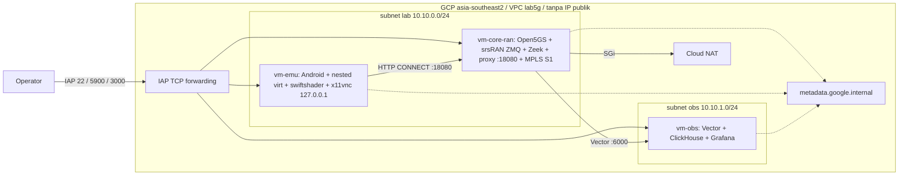
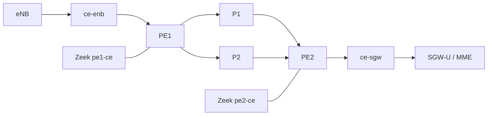

# Lab di GCP

Implementasi: [`infra/gcp/`](../infra/gcp/) (Terraform + startup) dan [`infra/mpls/`](../infra/mpls/).

## Topologi

- **Tanpa IP publik.** Ingress hanya dari rentang IAP `35.235.240.0/20` ke port 22, 5900, 3000. OS Login aktif.
- **Egress** lewat Cloud NAT. DNS UE 8.8.8.8.
- **Jam**: chrony ke `metadata.google.internal` di semua VM.
- **Penyimpanan**: pd-balanced (atau pd-standard), snapshot harian, bucket GCS untuk hasil/pcap (jangan publik).
- Core dan RAN satu host (ZMQ peka latensi). Emulator di VM terpisah dengan nested virtualization (seri Intel N2).

## Sizing (17 Nov 2026)

| Peran | Minimal | Optimal |
|---|---|---|
| vm-core-ran | n2-standard-4, 80–100 GB | n2-standard-8, 100 GB |
| vm-emu | n2-standard-4, 100 GB | n2-standard-8, 150 GB |
| vm-obs | e2-standard-2, 80 GB | e2-standard-4, 200 GB |
| Total | 10 vCPU / 40 GB | 20 vCPU / 80 GB |

Estimasi on-demand Jakarta (agregator harga, belum diverifikasi resmi): minimal ~USD 0,61/jam, optimal ~USD 1,22/jam. Matikan/destroy di luar jam tes.

## Kuota yang perlu dicek

`CPUS_ALL_REGIONS` (bisa lebih ketat dari kuota regional), `N2_CPUS` regional, `SSD_TOTAL_GB` (pd-balanced), `PREEMPTIBLE_CPUS` (jika `emu_spot = true`).

## Status uji IaC (FAKTA, 17 Nov 2026)

`terraform apply` (ukuran diperkecil) → smoke test PASS (3 VM tanpa IP publik, IAP SSH, Docker, chrony, NAT egress, ping internal, `/dev/kvm` di vm-emu, firewall, bucket) → `terraform destroy` bersih. Stack 5G/emulator penuh belum dipasang di GCP. Setup MPLS gagal karena modul `mpls_router` tidak ada di kernel default; skrip kini memasang `linux-modules-extra-$(uname -r)`.

## Backhaul MPLS S1 (USULAN)

Netns + veth di dalam vm-core-ran (VPC GCP tidak meneruskan frame MPLS antar-VM). FRR OSPF + LDP, BGP VPNv4 PE1–PE2, VRF `S1`. `tc netem` per link untuk injeksi delay/jitter/loss. Multi-VM hanya lewat GRE/VXLAN (penalti MTU; turunkan MTU tun ke ≤1400).

> VM `vm-mpls` opsional (`enable_mpls`) sedang disiapkan dan akan menyusul di commit berikutnya.

## Risiko

| Risiko | Mitigasi |
|---|---|
| Nested virt lambat / KVM tidak ada | Cek `/dev/kvm` di smoke test; seri N2 Intel |
| Image Android non-Play tidak eligible update app | Siapkan image Google Play x86_64 |
| Zeek tidak mengurai GTP di bawah label MPLS | Tap di sisi CE (tanpa label) |
| Fragmentasi GTP-U | MTU tun 1400 |
| Spot preemption memutus VNC | Default `emu_spot = false` |
| Port Cloud NAT habis | `min_ports_per_vm` 256, dynamic port allocation |
