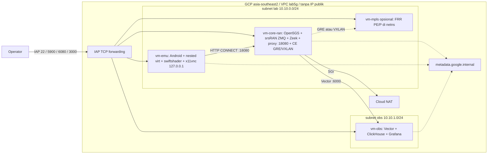
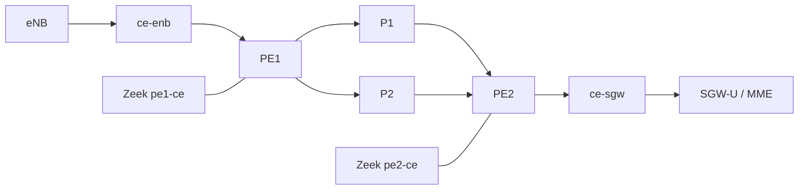

# Lab di GCP

Implementasi: [`infra/gcp/`](../infra/gcp/) (Terraform + startup) dan [`infra/mpls/`](../infra/mpls/).

## Topologi

- **Tanpa IP publik.** Ingress hanya dari rentang IAP `35.235.240.0/20` ke port 22, 5900, 6080, dan 3000. OS Login aktif. VNC yang bind ke loopback dijangkau dengan `gcloud compute ssh -L`, bukan `start-iap-tunnel`.
- **Egress** lewat Cloud NAT. DNS UE 8.8.8.8.
- **Jam**: chrony ke `metadata.google.internal` di semua VM.
- **Penyimpanan**: pd-balanced (atau pd-standard), snapshot harian, bucket GCS untuk hasil/pcap (jangan publik).
- Core dan RAN satu host (ZMQ peka latensi). Emulator di VM terpisah dengan nested virtualization (seri Intel N2).

## Sizing (17 Nov 2026)

| Peran | Minimal | Optimal |
|---|---|---|
| vm-core-ran | n2-standard-4, 80–100 GB | n2-standard-8, 100 GB |
| vm-emu | n2-standard-4, 100 GB | n2-standard-8, 150 GB |
| vm-obs | e2-standard-2, 80 GB | e2-standard-4, 200 GB |
| vm-mpls (opsional) | e2-medium, disk 20 GB | sama, atau e2-standard-2 |
| Total | 10 vCPU / 40 GB | 20 vCPU / 80 GB |
| Total + vm-mpls | 12 vCPU / 44 GB | 22 vCPU / 84 GB |

Estimasi on-demand Jakarta (agregator harga, belum diverifikasi resmi): minimal ~USD 0,61/jam, optimal ~USD 1,22/jam. Matikan/destroy di luar jam tes.

## Kuota yang perlu dicek

`CPUS_ALL_REGIONS` (bisa lebih ketat dari kuota regional), `N2_CPUS` regional, `SSD_TOTAL_GB` (pd-balanced), `PREEMPTIBLE_CPUS` (jika `emu_spot = true`).

## Status uji IaC (FAKTA, 17 Nov 2026)

`terraform apply` (ukuran diperkecil) → smoke test PASS (3 VM tanpa IP publik, IAP SSH, Docker, chrony, NAT egress, ping internal, `/dev/kvm` di vm-emu, firewall, bucket) → `terraform destroy` bersih.

Hasil tambahan, tanpa project ID atau identitas:

- Emulator di `n2-standard-4`: boot 135,9 s, ANR systemui saat Chrome dibuka.
- Emulator di `n2-standard-8`: boot 121,5 s, tanpa ANR. RAM sekitar 3,9 GB.
- Cloud NAT OK. tinyproxy OK.
- VNC lewat IAP SSH `-L`. `start-iap-tunnel` gagal karena port VNC bind ke loopback.
- MPLS: modul dan GRE PASS. L3VPN end-to-end FAIL karena LDP neighbor tidak terbentuk (known issue).
- Rekomendasi: `n2-standard-4` minimal, `n2-standard-8` untuk UI mulus.

`enable_obs` default true. Profil 12 vCPU di `terraform.tfvars.example` memakai `enable_obs=false` dan `enable_mpls=false` (core `n2-standard-4` + emu `n2-standard-8`).

## Hasil Hari 1 (FAKTA, disanitasi)

Profil: core `n2-standard-4`, emu `n2-standard-8`, `enable_obs=false`, `enable_mpls=false`. Tanpa project ID, IMSI, atau identitas. Skrip ada di `infra/gcp/day1/`.

- Attach OK.
- Ping UE ke UPF rata-rata 30,2 ms; ke 8.8.8.8 rata-rata 30,6 ms (100 paket, 0% loss).
- iperf UL 18,9 Mbit/s, DL 30,8 Mbit/s.
- Internet emulator lewat UE terbukti dari pcap `ogstun`.
- TTFB HTTP sekitar 190 ms lewat UE, sekitar 39 ms langsung.
- CPU steal 0%. ZMQ tanpa late/underflow.
- Biaya sekitar USD 0,3 untuk sekitar 20 menit.

Stack yang lulus: Open5GS 2.8.0 EPC, srsRAN_4G `release_23_11` di-build dari source (paket PPA tidak punya ZMQ), PLMN 001/01, TAC eNB dan MME 0x0001, subscriber acak lewat `mongosh`, proxy tinyproxy di netns UE. Proxy gost diuji pada 18 Nov (bagian di bawah).

## Proxy bench 18 Nov

Median HTTP TTFB / HTTP total / HTTPS total, 10 sampel. Angka mentah ada di [`results/2026-11-18-proxy-bench.csv`](results/2026-11-18-proxy-bench.csv). Label: A langsung, B tinyproxy + socat, C gost tanpa cache DNS, C2 gost + veth + DNS cache, C3mss sama dengan C2 plus MSS clamp 1360.

| Jalur | HTTP TTFB | HTTP total | HTTPS total |
|---|---:|---:|---:|
| Langsung | 36 ms | 37 ms | 135 ms |
| tinyproxy + socat | 204 ms | 705 ms | 497 ms |
| gost + veth + DNS cache | 101 ms | 102 ms | 352 ms |

- Batas bawah sekitar 89 ms karena 2× RTT ZMQ (sekitar 30 ms).
- MSS clamp 1360 tidak berpengaruh (C2 dan C3mss hampir sama).
- Penyebab utama yang ditemukan adalah DNS per request lewat UE. Cache resolver gost (TTL 300s, IPv4, 8.8.8.8) menurunkan TTFB HTTP dari seri tanpa cache.
- Target direvisi menjadi TTFB HTTP ≤ 100 ms.
- Ping UE ke 8.8.8.8 rata-rata 29,9 ms.
- CPU steal 0%.

## Backhaul MPLS S1 (USULAN)

`enable_mpls` default false. Jika true, Terraform membuat `vm-mpls` (e2-medium, disk 20 GB, `can_ip_forward = true`) di subnet lab. FRR PE/P berjalan di netns di `vm-mpls`. `net.mpls.platform_labels` diset per netns. Sisi CE di `vm-core-ran` memakai GRE (protokol 47) atau VXLAN (UDP 4789), tanpa label, karena VPC tidak meneruskan frame MPLS. Firewall internal mengizinkan kedua protokol itu. Startup tidak menjalankan topologi. `tc netem` tetap ada di skrip backhaul. MTU terowongan 1400.

Skrip kanonis: `infra/gcp/startup/mpls-backhaul.sh` dan `infra/gcp/startup/mpls-ce-tunnels.sh`. `infra/mpls/mpls-backhaul.sh` hanya rujukan.

## Risiko

| Risiko | Mitigasi |
|---|---|
| Nested virt lambat / KVM tidak ada | Cek `/dev/kvm` di smoke test; seri N2 Intel |
| Image Android non-Play tidak eligible update app | Siapkan image Google Play x86_64 |
| Zeek tidak mengurai GTP di bawah label MPLS | Tap di sisi CE (tanpa label) |
| Fragmentasi GTP-U | MTU tun 1400 |
| Spot preemption memutus VNC | Default `emu_spot = false` |
| Port Cloud NAT habis | `min_ports_per_vm` 256, dynamic port allocation |
