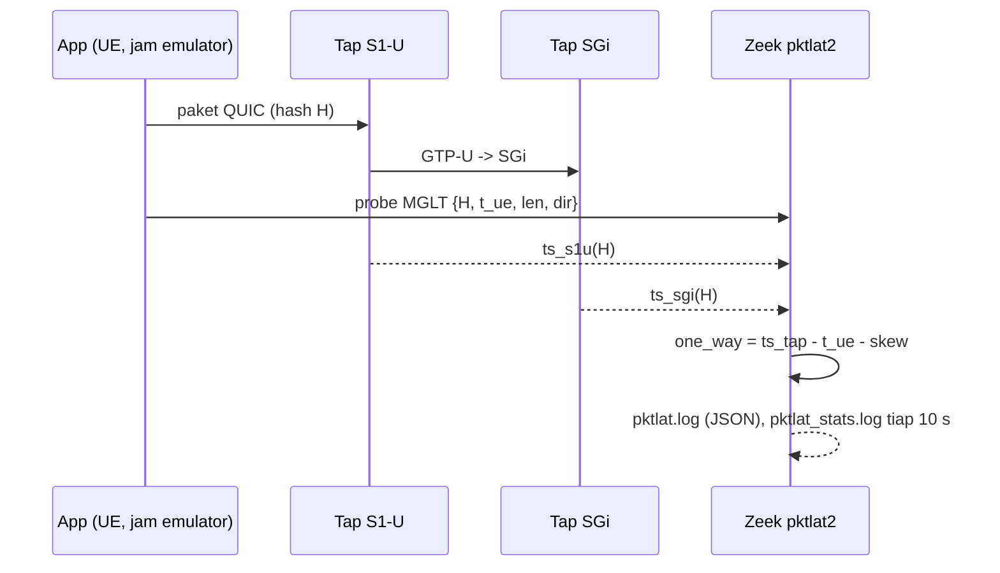

# PoC latency per paket end-to-end

Tujuan: mengukur one-way latency **per paket** dari aplikasi di UE sampai tiap titik tap jaringan (S1-U, S5/S8, SGi, dan nanti PE1/PE2 MPLS) dengan akurasi orde milidetik.

## Prinsip

1. **Stamp di sisi UE.** App (VpnService) mencatat `t_ue` untuk tiap write (UL) / read (DL) dan mengirimkannya sebagai **probe MGLT** (UDP ke sink :9001, out-of-band) — payload aplikasi tidak diubah.
2. **Kunci per paket.**
   - **QUIC (UDP/443, v2.1, default):** hash md5(payload UDP[0:64])[0:8 B]. Payload QUIC tidak berubah lewat SNAT/GTP, jadi hash yang sama terlihat di semua tap.
   - TCP: offset byte stream per flow (v2.0). **Dimatikan** (`PKTLAT2::tcp_on = F`); TCP memakai metode 3-way handshake terpisah.
3. **Zeek `pktlat2.zeek`** menyimpan ring buffer per flow per arah per tap (VLAN mirror → `s1u`/`s5s8`/`sgi`), lalu memasangkan record probe dengan paket kabel.
4. **Koreksi jam.** `one_way UL = ts_tap − t_ue − skew_s`, `DL = t_ue − ts_tap + skew_s`. `skew_s` (= offset VM − offset UE) diperbarui live lewat Config framework (`skew.cfg`). Android tanpa root tidak bisa chrony, jadi offset UE **diukur** (kalibrasi min-RTT) bukan disetel.

## Output

- `pktlat.log` — satu baris per paket: `dir`, `kind`, `len`, `ow_s1u/ow_s5s8/ow_sgi`, `one_way`, `seg`, `proto`, `qhash`, `status` (`ok`/`miss:<tap>`/`nomap`/`expired`), `run_id`.
- `pktlat_stats.log` — counter memori/cakupan.
- ClickHouse `poc_latency.pkt_latency`, `pktlat_stats`, `mglt_markers` ([skema](../observability/clickhouse/init.sql)).
- Grafana dashboard `poc-pktlat` ([JSON](../observability/grafana/dashboards/poc-pktlat.json)): one-way UL/DL per tap, p50/p90/p99, histogram, cakupan/miss, overhead probe.

## Hasil lab on-prem (FAKTA, 17 Nov 2026)

- Probe per paket QUIC tervalidasi dengan generator sisi UE (`tests/latency/77-ue-quic-gen.py` + `78-compare-quic.py`).
- Zeek pktlat2 ~93 MiB memori, CPU puncak ~10%.
- Skew jam VM ↔ emulator teramati ~−8 s s.d. −9 s sebelum koreksi → wajib chrony di VM dan kalibrasi offset UE.
- Chrome/YouTube di emulator dengan proxy HTTP global memakai TCP CONNECT, bukan QUIC — untuk uji QUIC per paket gunakan generator UE atau app tanpa proxy.

## Batasan

- Akurasi segmen app→S1-U dibatasi error offset UE (≤ setengah asimetri RTT) dan TTI ZMQ (~1 ms + grant UL).
- Segmen antar-tap di host yang sama (S1-U→SGi) akurat < 1 ms karena satu jam kernel.
- PTP di luar cakupan.

## Menjalankan

Lihat [`observability/README.md`](../observability/README.md) dan [`tests/latency/README.md`](../tests/latency/README.md).
