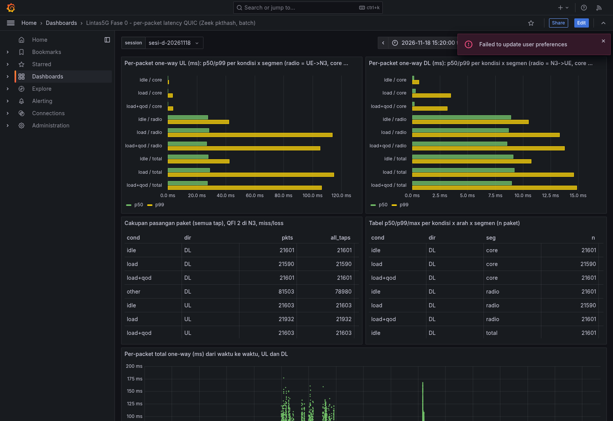

# Lintas5G Fase 0: penutupan (Sesi D, 18 Nov 2026) — verdict v2

Semua angka **FAKTA** hasil ukur di lab GCP (asia-southeast2-a), kecuali bagian bertanda **USULAN** atau **DUGAAN**.
Profil: vm-core-ran n2-standard-4 (Open5GS 2.8 EPC + srsRAN_4G ZMQ) + vm-emu n2-standard-8 (Android 16 Play Store, **headless**:
`gui_vnc=false`, tanpa public tunnel). Disk pd-standard (emu 250 GB). Zeek 3 tap paralel (UE/tun_srsue, N3/S1-U lo, N6/SGi ogstun).
Apply 15:36–15:38 WIB, destroy 17:55–17:58 WIB. Biaya sesi ~USD 2,0 (VM ~2,3 jam × ~USD 0,82/jam + disk/NAT/egress kecil) (kumulatif hari ini ~USD 3,4).

## 1. Restore sesi emulator (langkah 1)

| Bukti | Hasil |
|---|---|
| Restore direct-mount (stream GCS → sha256 → zstd → tar ke host dir, tanpa `docker cp`) | **25–27 s** (stream 23 s) untuk arsip 3,3 GB di pd-standard; sebelumnya `docker cp` >7 menit (tidak selesai) |
| Integritas | sha256 + manifest (api 36 / google_apis_playstore / Pixel C) cocok; userdata lokal dipertahankan saat container dibuat ulang |
| Akun | 1 akun Google (hitungan saja), tanpa wizard |
| adb | Arsip lama tidak berisi adbkey → adb `unauthorized`. `-skip-adb-auth` tidak berpengaruh pada image user build; input console emulator tidak sampai ke SystemUI (ANR). Diselesaikan dengan satu kali "Always allow" lewat noVNC sementara (AP1a, disetujui user 16:23/16:31 WIB, tunnel dimatikan 16:36 WIB) |
| Perbaikan permanen | Pasangan adbkey ikut arsip (`adb/`, 0600, tidak pernah dicetak). Arsip baru (generasi ke-2, versi lama tetap ada) diunggah 16:52 WIB. **Bukti:** restore paksa dari arsip baru → boot 56 s → adb `device` tanpa klik, akun 1 |
| Headless | Tidak ada listener 5900/6080/6081, tidak ada cloudflared, firewall IAP hanya 22/3000 |

## 2. QUIC pktlat (idle / beban / beban+QoD), 3 ulangan × 120 s

Generator `quic-gen.py`: paket QUIC long-header (versi grease) dari netns UE ke 3 server publik, dijawab Version Negotiation
→ RTT aplikasi per paket, 20 pps per target. Beban: iperf3 TCP DL 4 stream + UL 1 stream. QoD: AAR → adapter tc (any:443, GBR 5 Mbit/s).

| Ulangan | Kondisi | QUIC RTT p50 (ms, 3 target) | QUIC RTT p99 (ms) | Tanpa jawaban | Ping p50 (ms) |
|---|---|---|---|---|---|
| r1 | idle | 51,5 / 38,2 / 52,1 | 66,5 / 52,8 / 67,3 | 0,03% | 26,1 |
| r1 | beban | 358,0 / 326,3 / 361,7 | 564,5 / 503,4 / 574,0 | 1,7–2,8% | 329,2 |
| r1 | beban+QoD | 49,9 / 38,3 / 52,4 | 130,6 / 118,4 / 133,3 | 0% | 40,4 |
| r2 | idle | 51,1 / 38,8 / 51,9 | 65,6 / 53,3 / 66,6 | 0% | 26,9 |
| r2 | beban | 359,3 / 325,9 / 362,7 | 519,1 / 462,7 / 528,3 | 1,5–1,8% | 332,4 |
| r2 | beban+QoD | 49,8 / 38,3 / 52,3 | 133,0 / 120,9 / 136,2 | 0,04% | 40,9 |
| r3 | idle | 51,0 / 39,3 / 51,7 | 65,5 / 100,6 / 66,5 | 0% | 26,3 |
| r3 | beban | 351,6 / 316,5 / 354,4 | 549,5 / 485,7 / 548,6 | 1,3–1,9% | 326,8 |
| r3 | beban+QoD | 50,0 / 38,8 / 52,4 | 123,3 / 111,0 / 126,0 | 0,04% | 40,5 |

| Kriteria (QUIC) | Angka | Verdict |
|---|---|---|
| p99 turun ≥50% (beban → beban+QoD) | r1 76,5–76,9%; r2 73,9–74,4%; r3 77,0–77,6% | PASS |
| p50 QoD ≤2× idle | 0,97–1,01× | PASS |
| Loss QoD <1% | ≤0,04% | PASS |

Catatan: fase beban r3 bertepatan dengan boot emulator di vm-emu (server iperf). Angka r3 berada dalam rentang r1–r2, jadi tidak diulang.

### Per-paket (Zeek pkthash, tap-to-tap, batch ClickHouse)

692.779 baris tap; cakupan pasangan 3 tap **100%** di semua fase QUIC; capture_loss 0,0% di 3 tap.

| Arah | Segmen | idle p50/p99 | beban p50/p99 | beban+QoD p50/p99 (ms) |
|---|---|---|---|---|
| UL | radio (UE→N3) | 27,9 / 42,3 | 28,7 / 113,9 | 27,1 / 105,3 |
| UL | core (N3→N6) | 0,19 / 0,89 | 0,35 / 3,56 | 0,38 / 3,78 |
| DL | radio (N3→UE) | 8,9 / 10,5 | 8,7 / 13,3 | 8,6 / 13,8 |
| DL | core (N6→N3) | 0,16 / 0,63 | 0,31 / 3,50 | 0,20 / 3,19 |

**Temuan (FAKTA + interpretasi):** segmen UE↔N6 hampir tidak berubah oleh beban (kecuali UL radio p99 42 → 114 ms, kontensi
scheduler UL dengan bulk UL; QoD tidak memperbaikinya: 105 ms). Kenaikan RTT aplikasi ~300 ms dan perbaikan QoD terjadi di
**antrean tc HTB di SGi**, yang berada di luar segmen tap: pcap di ogstun melihat DL setelah qdisc egress dan UL sebelum shaping
ifb. **USULAN Fase 1:** tambah tap ke-4 setelah shaping (ens4 egress / ifb0) untuk segmen "sgi-queue", dan enforcement di UPF/RAN.

## 3. RCA TCP UL GBR 75%

Flow 5 Mbit/s UL ke vm-emu:18080 (kelas QoD + reservasi GBR), 30 s per kasus.

| Kasus | Setelan | Goodput | Retrans | RTT rata-rata |
|---|---|---|---|---|
| A | iperf3 `-b 5M`, beban penuh | 3,75 Mbit/s (75%) | 0 | 137 ms |
| B | tanpa `-b`, beban penuh | 5,24 Mbit/s (105%) | 18 | 185 ms |
| C | `--fq-rate 5M` (pacing kernel), beban penuh | 4,95 Mbit/s (99%) | 0 | 57 ms |
| D | `-b 5M`, headroom GBR 1,5 | 3,77 Mbit/s | 0 | 124 ms |
| E | `-b 5M`, hanya bulk DL | 3,76 Mbit/s | 0 | 115 ms |
| F | `-b 5M`, tanpa beban | 3,75 Mbit/s | 0 | 123 ms |
| G | UDP 5 Mbit/s (kontrol) | 4,90 Mbit/s, loss 2,7% | – | – |

**Kesimpulan (FAKTA):** 75% muncul identik dengan dan tanpa beban, dengan headroom 1,5, dan hanya-DL. Jadi bukan kontensi
atau reservasi QoD, melainkan artefak **throttle aplikasi iperf3 `-b` untuk TCP** (blok 128 KiB, RTT ~120–140 ms).
Dengan pacing kernel (C) goodput 99% dengan RTT terendah; tanpa limit (B) 105% tapi antrean naik (RTT 185 ms, retrans).
**DUGAAN** mekanisme detail: throttle iperf3 menunda write blok penuh saat rata-rata melewati target, digabung jendela
cwnd/ACK di RTT tinggi. **USULAN:** kriteria GBR TCP diukur dengan `--fq-rate` (pacing kernel). Verdict TCP UL: **PASS (99%)**
dengan metode yang benar; angka Sesi C (75,3%) adalah artefak pengukuran.

## 4. STR ×10 di bawah beban + stabilitas ZMQ

| Bukti | Hasil |
|---|---|
| STR → STA | 10/10 STA 2001 |
| Filter tc | 0 → 6 → 0 di 10/10 siklus |
| Latency remove adapter | 17,3–25,4 ms (median ~20) |
| RLF / link | 0 RLF di 10 siklus, link OK 10/10, 0 re-attach |
| Ping dengan QoD (n=1250) | p50 36,2 / p99 133 ms |
| Ping setelah STR, beban tanpa QoD (n=1454) | p50 339 / p99 507 ms (= level beban, prioritas benar-benar dilepas) |

Sesi C: 2 dari 4 STR memicu RLF ZMQ. Sesi D: 0/10, padahal dedicated bearer tetap dilepas tiap siklus (SGW-C Delete Bearer Request/Response 10×). **DUGAAN:** perbedaan karena health check + re-attach sebelum seri dan watchdog UE; belum dibuktikan dengan log MAC srsenb. Verdict: **PASS**.

## 5. K2 / K4 (headless) dan K7

| Kriteria | Hasil | Verdict |
|---|---|---|
| K2: UE 30 menit (ping loss, p95, gap, reattach) + iperf TCP DL/UL | ping 1800/1800 (loss 0%), p95 per 5 menit 40,7–41,2 ms, gap maks 1,03 s, reattach 0; iperf TCP DL 14,43 / UL 7,69 Mbit/s (batas HTB 15/8) | PASS |
| K4: YouTube headless (akun tes, via UE) | 16:43 WIB: akun 1, bot-check 0, playing 55/55 sampel, buffering 0, posisi maju 118 s dalam 120 s (YT_PASS=1). Ulang 17:51 WIB setelah container dibuat ulang (adb tanpa klik): akun 1, playing 55/55, maju 118 s (YT_PASS=1) | PASS |
| K7 (VNC/GUI) | N/A: sesi headless sesuai keputusan PM | N/A |

## 6. Verdict v2 (perubahan terhadap Sesi C)

| # | Kriteria | Sesi C | Sesi D | Verdict v2 |
|---|---|---|---|---|
| 13 | Goodput GBR TCP UL ≥95% | 75,3% | 99% (pacing kernel); 75% = artefak `iperf3 -b` | PASS |
| 16 | Latency kembali ke level beban setelah STR | N/A (RLF) | ping p50 339 / p99 507 vs beban ~330 / ~520 | PASS |
| 21 | p99 QUIC/HTTP3 turun ≥50% | – | 74–78% di 3 ulangan | PASS |
| 22 | Per-paket tap-to-tap (UE/N3/N6) + Grafana | – | cakupan 100%, loss 0% | PASS |
| 23 | Restore sesi emulator headless | belum terverifikasi | 25–27 s, adb tanpa klik setelah perbaikan adbkey | PASS (setelah 1× AP1a) |
| 7 | QFI 2 data-plane end-to-end | FAIL (UERANSIM) | belum diuji: IaC 5G SA siap (`ran_mode=sa-srsran`); prebuild gNB 24.10.1 + srsUE 23.11 (x86-64-v3, 15 MB) divalidasi di box (config gNB terparse, plugin RF ZMQ aktif); butuh Sesi E | OPEN |

## 7. Masalah dan perbaikan selama Sesi D

| Masalah | Dampak | Perbaikan |
|---|---|---|
| Arsip sesi lama tanpa adbkey → adb `unauthorized`; `-skip-adb-auth` tidak berlaku di image user build | Verifikasi akun/YouTube headless terblokir ~45 menit | Pasangan adbkey ikut arsip + diinjeksi sebelum start; 1× "Always allow" via noVNC sementara (disetujui user), arsip disimpan ulang |
| `docker start` container emulator yang sudah ada gagal (`sudo chown /dev/kvm` di entrypoint budtmo) | Emulator tidak boot setelah stop/start | Selalu buat ulang container (`FORCE=1`, ~20 s dengan direct mount); known issue di README |
| SA `lab5g-emu` hanya `objectViewer` di bucket sesi | Simpan ulang sesi gagal | Grant `objectAdmin` sementara (70 s) lalu dicabut |
| Parser `media_session` (Android 16 `state=PLAYING(3)`, posisi relatif `updated`) | YouTube headless salah FAIL | Regex dua format + ekstrapolasi posisi |
| `zeek-taps.sh` memanggil `$0` tanpa bash; awk `str-loop.sh` (`>` di printf) | Status tap / ping per siklus kosong | Diperbaiki; ping STR dihitung ulang dari file mentah |

## 8. Batasan

1. Enforcement QoD tetap di SGi (tc HTB), bukan UPF/RAN; segmen tap tidak mencakup antrean tc (lihat §2).
2. Probe QUIC adalah paket long-header + Version Negotiation (bukan handshake HTTP/3 penuh).
3. Radio srsRAN_4G ZMQ (bukan RF). QFI 2 end-to-end 5G SA belum diukur.
4. Dashboard batch setelah tes, dijalankan di box (vm-obs tidak dinyalakan karena kuota 12 vCPU).

## File

- Dashboard: `img/2026-11-18-sesi-d-pktlat.png` (skema `infra/gcp/sesi-d/obs/pkt-schema.sql`, dashboard `dashboard-pktlat.json`).
- Script: `infra/gcp/sesi-d/`, `infra/gcp/vnc/` (restore/save/adbkey/headless), `infra/gcp/sa/` (5G SA, belum di-apply).
- Pcap, log mentah (IMSI tes), arsip sesi, dan screenshot emulator tidak dipublikasikan.
