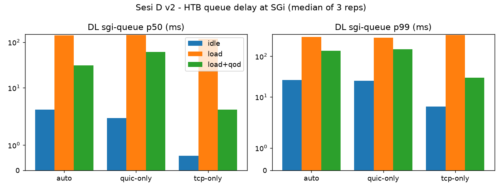

# Sesi D v2 — YouTube + QoD, matriks transport (auto / quic-only / tcp-only)

Tanggal: 18–19 Nov 2026 (WIB, Asia/Jakarta UTC+7). Lab: Lintas5G (EPC srsRAN 4G, UE `ue-l3` GRE egress, emulator Android 16 API 36 headless, CPU only, tanpa VNC/tunnel publik).
APK `magnon-poc-examine` v0.10.1-poc (sha256 `f0f85e6f…50c758c3`). Status: **hasil lab lengkap untuk playback + sgi-queue + transport; MGLT v2.1 coverage GAGAL (lihat §4).**

## 1. Linimasa (WIB)
| Waktu | Kejadian |
|---|---|
| 22:06:59 | terraform apply (jam biaya mulai) |
| 22:20 / 22:25 | emu / core siap; APK v0.10.1 + skrip sesi-d ter-deploy (+x), pktlat2 + tap sgiq aktif sebelum runner |
| 22:41:35 | matriks dimulai (`run-transport-matrix.sh`, 3 rep × 3 kondisi × 180 s per mode) |
| 23:13:42 | auto selesai (rc=0) |
| 23:46:50 | quic-only selesai (rc=0) |
| 00:20:58 | tcp-only selesai, ALL DONE |
| 00:24 – 00:30 | log dikumpulkan/diunggah, terraform destroy (+ retry satu kali, lihat §7), audit |

VPN: `VPN_CONSENT=ok`, tun 10.111.0.2/32, pada tiap run. Tidak ada RLF (rlf+=0 di semua 27 fase).

## 2. Playback (metrik resmi advance = PLAYING pertama → terakhir; median/rentang 3 rep)
| Mode | Kondisi | startup_s | stall (n/s) | advanced_s |
|---|---|---|---|---|
| auto | idle | 7.0 (6.0–7.0) | 0 | 173–176 |
| auto | load | 7.0 (7.0–9.0) | 0 | 171–173 |
| auto | load+qod | 6.0–7.0 | 0 | 173–177 |
| quic-only | idle | 7.0 | 0 | 173–174 |
| quic-only | load | 7.0 | 0 | 173 |
| quic-only | load+qod | 6.0–7.0 | 0 | 173–176 |
| tcp-only | idle | 35.0 / 7.0 / 6.0 | 1 (1.0 s, rep1) | 144 / 173 / 174 |
| tcp-only | load | 7.0 | 0 | 173 |
| tcp-only | load+qod | 6.0 / 35.0 / 6.0 | 0 | 174 / 145 / 174 |

Playback tidak terganggu oleh beban 15 Mbit/s DL (ABR menutupi; resolusi 360p). Dua outlier startup 35 s (tcp-only idle r1, load+qod r2) terjadi tanpa kaitan kondisi (satu di idle) — kemungkinan jitter start sesi/TCP, bukan efek QoD.

## 3. Transport (conn.log n6, per fase)
| Mode | Flow QUIC (udp/443) | Flow TCP (tcp/443) | Byte QUIC share | Catatan |
|---|---|---|---|---|
| auto | ~19 | ~42 | ~91% (idle), ~70% (load) | **Flow** didominasi TCP (video fallback + kontrol), **byte** didominasi QUIC. P1 otomatis = FAIL karena memakai jumlah flow; berdasarkan byte, auto ≈ QUIC |
| quic-only | 17–20 | 0–2 | 91–100% | filter berhasil |
| tcp-only | 0 | 49–69 | 0% | filter berhasil |

## 4. Cakupan MGLT IPv4 (v0.10.1) — GAGAL
- Probe v2.1 terkirim: `mglt2 closed probes=1960` (run tcp-only, log terakhir yang tersisa); v1 echo `tx=1571 rx=1519` (96.7%, RTT ~28–31 ms) — jalur IPv4 via route_fix **berfungsi untuk echo v1**.
- Namun di tap pkthash hanya 4–14 baris yang memuat port 9001 per tap (ue 5, n3 6, n6 14, sgiq-dl 7, sgiq-ul 4 pada run auto) dan `pktlat.log` kosong ⇒ coverage 0%, P5/P6 tidak bisa dinilai. Penyebab belum teridentifikasi (dugaan: filter/hash 64-B pada paket probe kecil, atau pkthash hanya mencatat sampel flow 443); lab sudah dihancurkan sebelum diagnosis. Tindak lanjut: periksa BPF + `pkthash.zeek` untuk udp/9001 secara offline dengan pcap kecil.
- Catatan: pkthash untuk tcp/udp 443 valid (26k baris/tap), sehingga segmen sgi-queue sahih.

## 5. Segmen sgi-queue (antrean HTB di SGi; n6 ↔ sgiq; median 3 rep, ms)
| Mode | Kondisi | DL p50 | DL p99 | UL p50 | UL p99 |
|---|---|---|---|---|---|
| auto | idle | 3 | 26 | 0 | 3 |
| auto | load | 140 | 299 | 77 | 312 |
| auto | load+qod | 31 | 136 | 0 | 6 |
| quic-only | idle | 2 | 25 | 0 | 4 |
| quic-only | load | 142 | 285 | 118 | 318 |
| quic-only | load+qod | 61 | 150 | 0 | 7 |
| tcp-only | idle | 1 | 6 | 0 | 3 |
| tcp-only | load | 118 | 333 | 126 | 322 |
| tcp-only | load+qod | 3 | 30 | 0 | 8 |

Temuan: beban bulk menaikkan antrean DL ke p99 ≈ 285–333 ms (satu rep tcp-only load mencapai 1.16 s); QoD (kelas terpisah) menurunkan p99 DL ke 30–150 ms dan UL ke <10 ms. Pada tcp-only QoD hampir menghapus antrean (p99 30 ms), pada QUIC/auto sisa antrean 136–150 ms (rep pertama quic-only 51 ms, rep 2–3 ~150 ms ⇒ variabilitas besar). Idle QUIC p99 ≈ 25 ms vs TCP ≈ 6 ms.

## 6. Kriteria (USULAN) per mode
| Kriteria | auto | quic-only | tcp-only |
|---|---|---|---|
| P1 transport sesuai mode | FAIL (flow-count; byte ≈ QUIC) | PASS | PASS |
| P2 stall | PASS | PASS | PASS |
| P3 startup | PASS | PASS | PASS |
| P4 advance ≥ 80% | PASS | PASS | PASS |
| P5 p99 DL n6 (MGLT) | n/a | n/a | n/a |
| P6 coverage MGLT ≥ 95% | FAIL (0%) | FAIL | FAIL |
| Verdict | INCOMPLETE | INCOMPLETE | INCOMPLETE |

Pada P1 untuk auto disarankan mengubah definisi menjadi share byte.

## 7. Biaya, destroy, deviasi
- Durasi lab 22:07 → 00:30 ≈ 2.4 jam × ~USD 0.82/jam ≈ **USD 2.0** (estimasi; Billing API nonaktif). Kumulatif hari ini ≈ USD 6.5 (< batas USD 12).
- Destroy: terraform destroy sempat error transien saat menunggu operasi hapus network (HTTP), diulang sekali (rc=0, state 0). Audit: tidak ada instance/disk/IP/firewall/router/NAT/bucket `lab5g-runs` tersisa; build-vm-01 TERMINATED; aset netprobe/magnon tidak tersentuh.
- Log tersunting disimpan di bucket privat state `logs/sesi-d-yt2/20261118/` dan di box `/workspace/sesi-d-yt2/`. Re-save sesi emulator dilewati.
- Deviasi: tc mirror + feeder sgiq (bukan nft dup), route_fix untuk MGLT, runner menarik berkas playback ke core, `run-transport-matrix.sh`; logcat `mglt2 closed` hanya tersedia untuk run terakhir; analisis memakai `yt-qod-analyze.py` offline (ClickHouse tidak dimuat) karena coverage 0.

> **Catatan v3 (19 Nov):** penyebab coverage MGLT 0% dan perbaikannya ada di `2026-11-19-sesi-d-youtube-qod-v3-mglt-recheck.md`.
