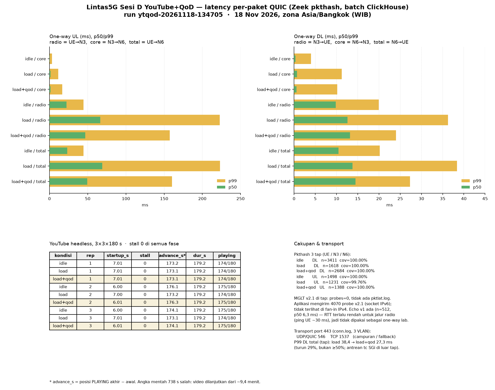

# Lintas5G Sesi D: YouTube + QoD + Booster examine v0.10.0 (18 Nov 2026)

Semua angka **FAKTA** hasil ukur di lab GCP (asia-southeast2-a), kecuali bagian bertanda **USULAN** atau **DUGAAN**.
Waktu di zona **Asia/Bangkok (WIB, UTC+7)**. Profil sama dengan Sesi D sebelumnya: vm-core-ran n2-standard-4
(Open5GS 2.8 EPC + srsRAN_4G ZMQ) + vm-emu n2-standard-8 (Android 16 / API 36 Play Store, Pixel C, **headless**:
`gui_vnc=false`, tanpa public tunnel, GPU none). Egress emulator **ue-l3** (GRE). Disk pd-standard (emu 250 GB).
Kuota 12 vCPU; vm-obs tidak dinyalakan. ClickHouse batch di box.

Apply 20:21–20:23 WIB, tes resmi `ytqod-20261118-134705` 20:47–21:19 WIB, destroy 21:28–21:31 WIB (147 resource, rc=0).
Biaya sesi ini **~USD 1,1** (VM ~1,1 jam × ~USD 0,82/jam + disk/NAT/egress kecil). Kumulatif hari ini
**~USD 4,5**, di bawah batas USD 12. Resource `build-vm-01` dan netprobe/booster tidak disentuh.

## 1. Timeline (WIB)

| Waktu | Peristiwa |
|---|---|
| 20:17 | Persetujuan user: apply, tes, destroy |
| 20:20:55–20:20:57 | `terraform plan` (147 create, 0 update/destroy, 0 resource terlindungi) |
| 20:21:09–20:22:48 | `terraform apply` (rc=0). Metadata: `ran-mode=epc-srsran4g`, `gui-vnc=false`, `gui-public-tunnel=false`, `gui-emu-egress=ue-l3`, API 36, Pixel C, GPU none |
| 20:23:54 | Core: instal Open5GS + kompilasi srsRAN |
| 20:24:11 | Emu: bring-up headless, `session_uri=set` |
| ~20:31 | Restore sesi: stream 23 s, total **27 s**, `adbkey=persisted`, manifest API 36 / Play Store / Pixel C cocok |
| 20:33:00 | `BOOT_COMPLETED=1` dalam 62 s; adb **device** (tanpa klik); Play Store ada; `vnc=0` |
| 20:33:01 | Emu siap. Host: tidak ada listener 5900/6080/6081, tidak ada cloudflared. Hanya `127.0.0.1:5555` (adb) |
| 20:34:31 | Core `ready`: UE attach, keepalive/watchdog aktif, GRE emu, ping 8.8.8.8 0% loss (~31 ms) |
| 20:39:36–20:40:01 | `core-prep`: re-attach setelah PCRF, HTB DL 15 / UL 8 Mbit/s, adapter QoD :8090, Zeek pkthash 3 tap. `ue_ip=<UE_IP>` |
| 20:40 | `emu-prep`: APK v0.10.0 (`versionCode=11`, `targetSdk=36`, sha256 `9783a2fa…cbb43`) terpasang; `ACTIVATE_VPN=allow`; `POST_NOTIFICATIONS=granted` |
| 20:40:25–20:40:46 | Consent VPN headless: lihat §2 |
| 20:41:40–20:44:05 | Percobaan pertama dihentikan (skrip di emu belum `+x`; `ZEEKPATH` pktlat2 menimpa path stock). Diarsipkan, tidak dipakai |
| 20:47:05 | Tes resmi mulai (`REPS=3 DUR=180 GAP=20`, video `aqz-KE-bpKQ`) |
| 20:47:26 | VPN lagi: fallback MainActivity, `VPN_CONSENT=ok`, tun0 `10.111.0.2/32`, examine v0.10.0-poc |
| 20:47:33 | Skew awal `skew_s=0.4730` (akhir tes `0.6116`) |
| 20:50:38 … 21:18:49 | 9/9 fase selesai, RLF +=0 di semua fase |
| 21:19:18 | `ytqod done` |
| setelah itu | Artefak diunduh, batch ClickHouse + bagan di box, destroy + audit |

Akun Google: **1** (hanya hitungan; nama/email tidak dicatat). Log bring-up sempat menulis `accounts=2` saat boot; `dumpsys` setelah boot = 1 akun tipe `com.google`.

## 2. Consent VPN (headless, API 36)

Urutan: `appops set … ACTIVATE_VPN allow`, `pm grant POST_NOTIFICATIONS`, lalu
`am start-foreground-service` ke `ExamineVpnService`. Jika `tun0` belum naik, fallback `am start` MainActivity.
Tidak ada VNC, tidak ada public tunnel, tidak ada perubahan IAM.

| Langkah | Hasil |
|---|---|
| `start-foreground-service` | Gagal: `Error: Requires permission android.permission.BIND_VPN_SERVICE` |
| Fallback MainActivity | **`VPN_CONSENT=ok`** `source=MainActivity prepared=true` |
| `POST_NOTIFICATIONS` | granted (non-blocking) |
| `tun0` | naik, `10.111.0.2/32`, MTU 1400, route `0.0.0.0/0`, DNS 8.8.8.8, `quic=fwd`, probe `10.99.9.20:9001`, mark `:9000` |
| Allowed apps | examine + `com.google.android.youtube` |
| Tes resmi (20:47) | pola yang sama; tun0 tetap naik sampai akhir |

**Go** untuk menjalankan tes penuh. Consent tidak memerlukan klik di perangkat.

## 3. YouTube per fase (startup, stall, advance)

Parser `advanced_s` mentah (~738 s) **salah**: setiap fase YouTube **melanjutkan** video dari ~9,4 menit (`pos` pertama saat PLAYING ~565 s), lalu maju ~1×. Angka di tabel adalah **posisi PLAYING akhir − awal**. Startup dan stall berasal dari JSON `yt-playback.py` (tidak terpengaruh). Resolusi/itag tidak tersedia.

| Kondisi | Rep | startup_s | stall | stall_s | advance_s (koreksi) | dur_s | playing/180 |
|---|---:|---:|---:|---:|---:|---:|---:|
| idle | 1 | 7,009 | 0 | 0 | 173,2 | 179,2 | 174 |
| load | 1 | 7,011 | 0 | 0 | 173,1 | 179,2 | 174 |
| load+qod | 1 | 7,006 | 0 | 0 | 173,1 | 179,2 | 174 |
| idle | 2 | 6,004 | 0 | 0 | 176,1 | 179,2 | 175 |
| load | 2 | 7,005 | 0 | 0 | 173,2 | 179,2 | 174 |
| load+qod | 2 | 6,006 | 0 | 0 | 176,3 | 179,2 | 175 |
| idle | 3 | 6,005 | 0 | 0 | 174,1 | 179,2 | 175 |
| load | 3 | 7,010 | 0 | 0 | 173,1 | 179,2 | 174 |
| load+qod | 3 | 6,010 | 0 | 0 | 174,1 | 179,2 | 175 |

RLF = 0 di 9/9 fase. UE keepalive/watchdog tetap aktif; ping UE 0% loss selama sesi.

## 4. Transport: QUIC vs TCP

`emu proto-hint` mengembalikan UDP=0 TCP=0 (parser di perangkat tidak berguna). Angka di bawah dari `conn.log` Zeek pktlat2 (port 443, tiga VLAN fan-in) dan `pkthash` (hanya QUIC).

| Sumber | UDP/443 (QUIC) | TCP/443 |
|---|---:|---:|
| conn.log, seluruh tes (termasuk di luar jendela fase) | 546 | 1537 |
| conn.log di fase idle / load / load+qod | 180 / 183 / 177 | 368 / 492 / 370 |
| pkthash (3 tap, hanya QUIC) | 12.287 / 12.284 / 12.284 baris (UE/N3/N6) | — |

**FAKTA:** ada aliran QUIC di setiap kondisi, tetapi **TCP/443 lebih banyak** — fallback TCP terjadi. Examine mem-forward QUIC (`quic=fwd`).

## 5. MGLT v2.1 dan one-way

| Bukti | Hasil |
|---|---|
| `pktlat.log` | **tidak ada** (hanya `pktlat_stats.log`) |
| pktlat2 `probes` / `ul_ok` / `dl_ok` / `q_ul_ok` | 0 sepanjang tes |
| `conn.log` udp/9000 dan udp/9001 | **0** |
| Logcat examine | `mglt2 ready` terikat `[::]:40366` (socket IPv6); akhir tes `mglt2 closed probes=4070 bytes=699240 recs=12190 resent=12190 err=0` |
| Echo MGLT v1 (udp/9000) | 512 TX + 512 echo `crc_ok`, p50 6,3 / p99 85,8 / max 218 ms |

**DUGAAN:** probe v2.1 keluar lewat socket IPv6 dan tidak masuk fan-in IPv4 + sink IPv4 `10.99.9.20:9001`. Echo v1 sampai ke aplikasi, tetapi RTT p50 6,3 ms jauh di bawah ping UE (~30 ms), jadi **bukan** one-way jalur radio; tidak dipakai untuk verdict p50/p99 lab.

Overhead probe (dari log aplikasi, 4070 paket / 699 kB ≈ 2,9 kbit/s rata-rata selama ~32 menit tes) kecil dibanding YouTube. Tidak terukur di tap.

One-way lab yang sah: **pkthash tap-to-tap** (batch ClickHouse, §6).

## 6. Per-paket pkthash (UE / N3 / N6) + ClickHouse

36.855 baris tap dimuat ke ClickHouse (`poc_latency.pkt_tap` / `pkt_phase`, session `sesi-d-yt-20261118`) lalu dihitung lewat `v_pkt_q` / `v_pkt_cov`. `capture_loss` percent_lost = 0,0% di 3 tap.

Cakupan 3 tap: **100%** idle/load+qod (kedua arah) dan DL load; UL load **99,76%** (3 paket).

| Arah | Segmen | idle p50/p99 | load p50/p99 | load+qod p50/p99 (ms) |
|---|---|---|---|---|
| UL | radio (UE→N3) | 22,2 / 44,4 | 66,3 / 222,9 | 46,9 / 157,4 |
| UL | core (N3→N6) | 0,43 / 3,24 | 1,28 / 11,5 | 1,44 / 16,7 |
| UL | total (UE→N6) | 23,1 / 44,6 | 69,1 / 223,0 | 49,3 / 160,2 |
| DL | radio (N3→UE) | 9,85 / 20,0 | 12,6 / 36,3 | 13,2 / 24,0 |
| DL | core (N6→N3) | 0,35 / 3,97 | 0,72 / 11,3 | 0,58 / 10,2 |
| DL | total (N6→UE) | 10,5 / 20,2 | 13,8 / 38,4 | 14,4 / 27,3 |

**Temuan (konsisten Sesi D):** p99 DL total turun 38,4 → 27,3 ms (**29%**, bukan ≥50%). QoD di tc SGi berada di **luar** segmen tap (pcap ogstun melihat DL setelah qdisc egress). UL radio memburuk di beban (p99 44 → 223 ms) dan hanya sebagian pulih dengan QoD (157 ms) — kontensi scheduler UL + bulk iperf UL.

## 7. Kriteria (USULAN) dan verdict

| ID | Kriteria | Angka | Verdict |
|---|---|---|---|
| P1 | Transport QUIC (udp/443) di setiap fase, atau ditandai fallback TCP | QUIC ada di semua fase, tetapi TCP/443 2–3× lebih banyak | **FLAG** (fallback TCP) |
| P2 | stall load+qod ≤ idle (atau keduanya 0) | stall 0 di 9/9 | **PASS** |
| P3 | startup load+qod ≤ 1,5× idle (atau idle+2 s) | 6,0–7,0 s vs idle 6,0–7,0 s | **PASS** |
| P4 | advance_s ≥ 80% durasi di load+qod | 173–176 s / 179 s (96–98%), setelah koreksi posisi | **PASS** |
| P5 | p99 one-way DL n6 (MGLT) load+qod ≤ 50% fase load, n≥100 | MGLT tidak ada di tap | **N/A**. Pkthash DL total p99 turun hanya 29% (bukan gerbang P5) |
| P6 | cakupan MGLT ≥ 95% | 0% (tidak ada match) | **FAIL**. Cakupan pkthash 99,76–100% |

Verdict keseluruhan (USULAN): **PARTIAL**. Pemutaran YouTube headless stabil di idle/beban/QoD (tanpa stall, startup datar, posisi maju 1×). Pengukuran one-way MGLT v2.1 gagal di jalur tap. Efek QoD pada p99 DL di tap tidak mencapai 50% (sesuai batasan Sesi D: shaper di luar tap).

## 8. Destroy dan audit

Destroy 21:28:07–21:30:45 WIB, rc=0, **147 resource** (sama dengan plan/apply). Log: `/workspace/sesi-d-yt-destroy.log`.

| Cek | Hasil |
|---|---|
| State terraform | 0 resource |
| vm-core-ran / vm-emu | tidak ada |
| `build-vm-01` | **TERMINATED**, tidak diubah |
| Firewall netprobe / booster (v4, v6, tcp-18771) | tetap ada |
| Jaringan `lab5g` | tidak ada (hanya `default`) |
| Bucket sesi emulator (di luar terraform) | tidak dihapus (log merah di `logs/sesi-d-yt/20261118/`) |
| Git commit/push/PR | tidak ada |

Biaya sesi ~USD 1,1; kumulatif hari ini ~USD 4,5.

## 9. Deviasi

1. `am start-foreground-service` ditolak `BIND_VPN_SERVICE`; fallback MainActivity berhasil setelah `appops`.
2. Objek skrip dari GCS tidak executable; perlu `chmod +x` di core dan emu.
3. `pktlat2-taps.sh` men-set `ZEEKPATH` hanya ke skrip site, Zeek 9.0.1 gagal (`can't find base/init-bare.zeek`). Diperbaiki dengan prefiks ke `--zeekpath` stock; diperbaiki juga di worktree (tanpa commit).
4. Satu percobaan runner dihentikan (20:41–20:44) dan diarsipkan; tes resmi 20:47–21:19 bersih 9/9.
5. JSON/TSV playback ditulis di vm-emu, tidak tersalin ke core, sehingga ringkasan on-box awal kosong. Dihitung ulang di box.
6. Probe MGLT v2.1 tidak muncul di tap (lihat §5).
7. `advanced_s` mentah salah karena resume posisi YouTube; dikoreksi.
8. SSH core→emu memakai kunci ed25519 lab-only di `/root/.ssh` (bukan IAM tambahan). Simpan-ulang arsip sesi **dilewati** (akan butuh IAM ekstra).
9. ClickHouse: instance yang sudah ada di box tidak dipakai (tidak ada kredensial). Batch-load di ClickHouse 24.8 Docker `127.0.0.1:18123`.
10. Tidak ada re-tes setelah temuan IPv6/MGLT — tidak menambah waktu/biaya di luar rencana 3×3×180 s.

## 10. File

- Bagan: `img/2026-11-18-sesi-d-youtube-qod.png`
- Skrip: `infra/gcp/sesi-d/` (termasuk perbaikan `ZEEKPATH` di `pktlat2-taps.sh`)
- APK v0.10.0 di box (bukan di repo publik)
- Log merah (tanpa akun, adbkey, arsip sesi, atau payload) di bucket privat `logs/sesi-d-yt/20261118/` dan salinan di box `/workspace/sesi-d-yt/`
- Pcap, logcat mentah, pktlog examine, `conn.log` (alamat tujuan), dan arsip sesi **tidak** dipublikasikan
